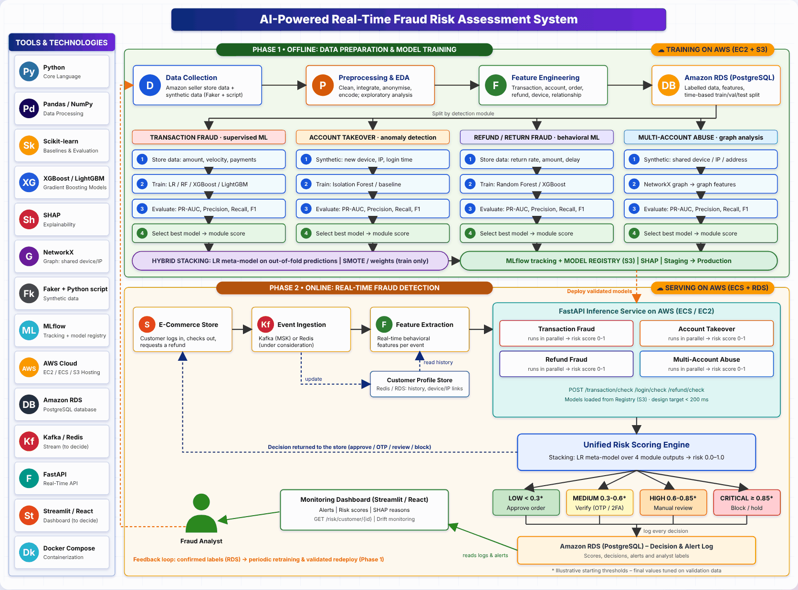

# AI-POWERED REAL-TIME FRAUD RISK ASSESSMENT SYSTEM

<a target="_blank" href="https://cookiecutter-data-science.drivendata.org/">
    
</a>

An AI-powered system for assessing fraud risk in real time.

## System Roadmap



## Project Organization

```
├── Makefile           <- Makefile with convenience commands like `make data` or `make train`
├── LICENSE            <- MIT license
├── README.md          <- The top-level README for developers using this project.
├── data
│   ├── external       <- Data from third party sources.
│   ├── interim        <- Intermediate data that has been transformed.
│   ├── processed      <- The final, canonical data sets for modeling.
│   └── raw            <- The original, immutable data dump.
│
├── docs               <- A default mkdocs project; see www.mkdocs.org for details
│
├── models             <- Trained and serialized models, model predictions, or model summaries
│
├── notebooks
│   └── 1.0-data-exploration.ipynb <- Exploratory analysis of the raw exports.
│
├── pyproject.toml     <- Project configuration file with package metadata for 
│                         ai_powered_real_time_fraud_risk_assessment_system and tool configuration
│
├── references         <- Data dictionaries, manuals, and all other explanatory materials.
│
├── Roadmap
│   ├── Fraud_Risk_Assessment_System_Roadmap (1).html <- Interactive system roadmap.
│   ├── Fraud_Risk_Assessment_System_Roadmap.png    <- High-resolution static roadmap.
│   └── Fraud_Risk_Assessment_System_Roadmap.gif    <- Full-resolution animated roadmap.
│
├── reports            <- Generated analysis as HTML, PDF, LaTeX, etc.
│   └── figures        <- Generated graphics and figures to be used in reporting
│
├── requirements.txt   <- The requirements file for reproducing the analysis environment, e.g.
│                         generated with `pip freeze > requirements.txt`
│
└── ai_powered_real_time_fraud_risk_assessment_system <- Project source code.
    │
    ├── __init__.py             <- Makes the project source a Python module
    │
    ├── config.py               <- Store useful variables and configuration
    │
    ├── dataset.py              <- Scripts to download or generate data
    │
    ├── features.py             <- Code to create features for modeling
    │
    ├── modeling                
    │   ├── __init__.py 
    │   ├── predict.py          <- Code to run model inference with trained models          
    │   └── train.py            <- Code to train models
    │
    └── plots.py                <- Code to create visualizations
```

--------
